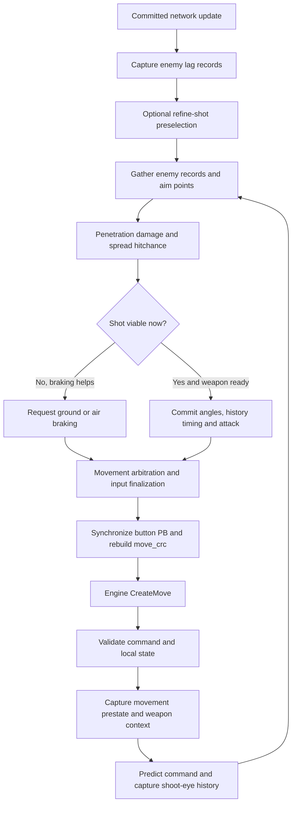

# Velocity ragebot source walkthrough — 2026-10-17

This is an inspection of the supplied local Velocity checkout, not a claim that its signatures, offsets or features work in the currently installed CS2. No runtime code was changed during this review. The user requested understanding/explanation before implementation.

Reference root: C:/Users/ollim/Desktop/cs2/velocity-cs2/project
Port root: C:/Users/ollim/Desktop/cs/cs2-internal-master

## End-to-end flow

The command path owns the final decision. Rendering displays results. A useful target, a planned stop, and a committed shot are distinct states.

## 1. Engine hook and command ownership

`core/hooks/impl/cheat.cpp:285` implements CreateMove. It detects commands marked as subtick overwrites; that path handles weapon selection and exits. On an ordinary command it calls the original builder first, validates the living local player, camera, movement services and last processed command, then refreshes the current command pointer.

The ordinary feature order is: clear/rebuild subtick movement; capture prestate; refresh shared weapon context; preliminary combat/movement features; ragebot; post-combat movement (including subtick autostop); quickpeek; final movement cleanup; input apply. This order matters because braking and aiming must describe the same command.

`core/systems/impl/input.cpp` performs final movement reconciliation, synchronizes all three legacy button words into the button protobuf, and rebuilds move_crc. This field contains canonical serialized button/angle data. It is not an ordinary numeric CRC32.

`core/hooks/impl/cheat.cpp:431` separately preserves visible camera angles around the view handler. Submitted command/history angles can therefore differ from the displayed camera.

## 2. Fresh enemy records

At frame stage 6, after the original network-update callback, `cheat.cpp:271` captures lag records. Each record carries the target identity, simulation time/tick, origin and bones. New simulation ticks produce new records; dead/removed entities and expired poses are removed.

`shared.cpp:488` validates age against a compensated server tick. The implementation uses server tick plus outgoing-latency ticks, with a budget derived from sv_maxunlag and sv_maxunlag_player minus a one-tick margin. There is also a configured backtrack-span limit. These rules keep the selection within the source implementation's intended server history window.

## 3. Weapon context and prediction

`shared.cpp:942` refreshes the active weapon, VData, range, type, item definition, recoil index, pellet count, movement-speed limit and scoped state.

`rage.cpp:581` captures spread/inaccuracy, then temporarily simulates the command. During that simulation it samples the predicted velocity, ground state, weapon accuracy and shooting-position history. `core/systems/impl/prediction.cpp` backs up and restores the touched player, movement, weapon and prediction state. Missing required helpers cause a fallback to prestate.

This is more than extrapolating position by velocity times frame duration. Spread and the shot origin need to correspond to the state in which the shot will be processed.

## 4. Weapon readiness

`shared.cpp:1427` rejects an empty magazine or reload for guns. For a normal firearm it requires the command client tick to reach next-primary-attack tick and controller tick base to be at least two ticks after the last committed shot. Knife and revolver paths have their own conditions.

`rage.cpp:422` resets transient per-command flags and dispatches guns, taser, knife or revolver. A miss does not set a permanent disable flag. Normal command processing continues on following commands.

## 5. Enemy and record selection

`rage.cpp:939` filters local/dead/friendly/immune players and obtains valid records. It can append a bounded extrapolated record when the newest real record is stale. It selects up to five records: newest first, then spatially separated poses, skipping near-duplicates.

`extrapolation.cpp:101` requires at least two stale ticks, caps the extrapolation to the configured 1–6 ticks, uses velocity and a bounded direction change, predicts movement with collision, shifts the stored bones, and rejects an embedded final hull. The gun scanner restricts extrapolated records to torso regions. This is still a prediction, not a confirmed server pose.

## 6. Shoot-eye candidates

`shared.cpp:798` snapshots the engine shooting-position ring along with client/server timing and interpolation. `get_candidates():873` chooses valid recent eye entries, optionally retaining a second position if sufficiently separated. It carries position, player tick/fraction and interpolation metadata together.

`rage.cpp:1212` scans from those positions. If no ring candidate exists it uses the current shooting position and marks it uninterpolated. The same source-eye metadata follows the winning target into fire_gun.

## 7. Hitboxes and multipoints

`rage.cpp:2207` obtains hitboxes for each target record and transforms them with that record's bones. Enabled hitbox regions and force-body settings select the scan order. Centers are generated first; multipoints are added around actual capsule/box surfaces.

`rage.cpp:3405` shrinks dynamic pointscale as spread/inaccuracy and distance consume the available hitbox radius. Points are deduplicated. A sufficiently strong center can suppress unnecessary peripheral scans. FOV filtering happens before penetration work.

Velocity uses a discrete point search, rather than the continuous angular damage heatmap in our port. The heatmap can remain the search method, but it needs the same reliable live inputs and command-time checks.

## 8. Penetration and damage

`shared.cpp:134` prepares the selected target record, traces through engine world geometry, invokes the engine bullet calculation, identifies the actual target/region intersected and applies damage scaling. Related trace hooks make the target-record geometry available during the trace.

`rage.cpp:2409` rejects points with no valid penetration result, insufficient damage, or a penetration-reported hitgroup inconsistent with the intended region. This avoids ranking head hitchance against damage actually delivered to another region.

Our earlier dump audit and the local Velocity source do not agree in every low-level contact-field interpretation. Current-engine disassembly/behavior must decide those details; copying this source's raw offsets is not sufficient validation.

## 9. Hitchance and ranking

`shared.cpp:1034` samples the engine weapon spread calculation (256 samples by default), incorporating inaccuracy, spread, recoil index, item definition and pellet count. Samples are cached by those inputs. Rays are tested against the selected record's transformed capsule or oriented box. Hitchance is the fraction that intersects that hitbox; it is not a guarantee of server damage through every obstruction.

`rage.cpp:2523` keeps a bounded representative set of points per record. Candidates passing the required hitchance are preferred over fallback candidates. Ranking then considers lethal damage, kill probability, health-capped expected damage, direct visibility, newer record, center point and smaller FOV. A valid fallback can be used to plan stopping even if it cannot fire yet.

## 10. Autostop and the final fire decision

`rage.cpp:1147` compares current hitchance with the configured ground/air threshold, including optional lethal-air overrides. It evaluates hypothetical stopped accuracy to decide whether braking would make a shot worthwhile. It can plan a short ground trajectory, an air brake/apex, or a landing opportunity.

Ground stop targets are based on weapon maximum speed divided by three. `rage.cpp:3578` applies stop settings and excludes unscoped sniper stopping. Movement code owns the actual command edits: the optional ground subtick emitter runs after the current rage decision; the airstrafer owns airborne braking. Two braking writers must not fight over the same command.

`subtick_autostop.cpp:81` simulates ground friction/acceleration in 32 slices and emits changes from the previous movement impulses, releasing braking when the speed budget is reached. This demonstrates why absolute base axes and accumulated subtick deltas must be reconciled.

Auto-scope, duck release, doubletap recharge, stop feasibility and air-latch conditions can defer firing. The decision is reconsidered on following commands.

## 11. Shot commit and repetition

`rage.cpp:3126` stamps all input-history angles with aim minus recoil, stamps target-record render timing, and, when available, the selected shoot-eye player timing. It adjusts interpolation fields and points attack1_start_history_index at the last stamped entry. It also sets matching base-command angles. Visible view is changed only when silent mode is disabled.

For a normal shot the source sets attack in value, value_changed and value_scroll. It updates last_shoot_tick. Subsequent commands must pass weapon readiness and the final target/accuracy gates again. Button synchronization and move_crc finalization happen after feature writers finish.

The source's normal firing path should not be confused with its optional doubletap path, which deliberately constructs subtick press/release events and a recharge state.

## 12. Refine Shot and special paths

Refine Shot (`rage.cpp:642`) preselects a shot at the committed network update, estimates the next eye position, and stores a stamped result consumed once by the command path. The command path recomputes current accuracy and firing gates, but does not perform a fresh full penetration scan for every reused refined result. It is therefore not a substitute for complete command-time revalidation.

Separate source paths implement no-spread seed correction, doubletap press/release with recharge, revolver cock/recovery, knife slash/stab/backstab, taser targeting, auto-scope and duckpeek coordination. Their settings and state machines cannot be reduced to the ordinary gun attack bit. The nine weapon groups supply different damage, hitchance, FOV, hitbox, pointscale and optional-feature settings.

## 13. Confirmed port differences

| Concern | Current port observation | Consequence |
| --- | --- | --- |
| Repeated fire | input.cpp rage_tick retains synthetic attack and clears later press edges; value_scroll attack is cleared | A concrete difference from normal Velocity fire; likely relevant to one-shot behavior, not proven to be the sole cause |
| Regression coverage | test_rage_input.cpp expects later press edges to remain zero | The test preserved the faulty behavioral assumption |
| Readiness | rage_tick has no equivalent live magazine/reload/next-primary/tick-base gate | Aim publication is incorrectly conflated with readiness to commit a shot |
| Spread input | service.cpp copies model.kernel; the normal live path does not populate it from engine weapon spread/inaccuracy | Normal unconfigured operation can evaluate an unspread ray and overestimate accuracy |
| Record timing | Port stamps angles and history index, but not the selected record's render/player timing | Command-time geometry and server rewind can disagree |
| Freshness | Worker reads live geometry while solving a copied snapshot; only an age cutoff guards publication | Inputs can describe different times; final selected-point check still uses the chosen model |
| Movement ownership | Port autostop follows active aim rather than Velocity's separate planned-stop/committed-shot state | Braking and firing decisions are coupled differently |
| Final submission | Direct command lookup, three-word PB sync, move_crc and camera preservation now exist | These bindings passed offline/synthetic checks; that does not validate the full game lifecycle |
| Feature parity | Menu exposes master/auto-fire, but not Velocity's full weapon-group policy | The current port is not a complete Velocity ragebot |

## 14. Implementation sequence after discussion

1. Add per-command diagnostics for readiness, target identity, command/shot timing and a single explicit rejection reason. Separate shot requests from confirmed weapon_fire/ammo changes.
2. Correct attack ownership/repetition with meaningful multi-shot, cooldown, reload, weapon-switch, duplicate-command and disable regressions.
3. Capture live weapon accuracy, movement and shoot-eye information at an appropriate game-thread boundary. Keep worker computation on immutable captured data; revalidate a candidate against the current command before firing.
4. Integrate valid enemy record snapshots and coherent history timing before claiming backtrack/extrapolation parity.
5. Connect heatmap damage/probability selection to these inputs and to stop-request versus shot-commit states. Keep the recovered stopping mathematics where its assumptions match.
6. Add only the optional weapon policies explicitly selected for the project, with a tested dependency path for each. Do not silently advertise menu features without their runtime state machines.

No new build was produced during this walkthrough. The existing package still has the firing and live-input limitations above.
